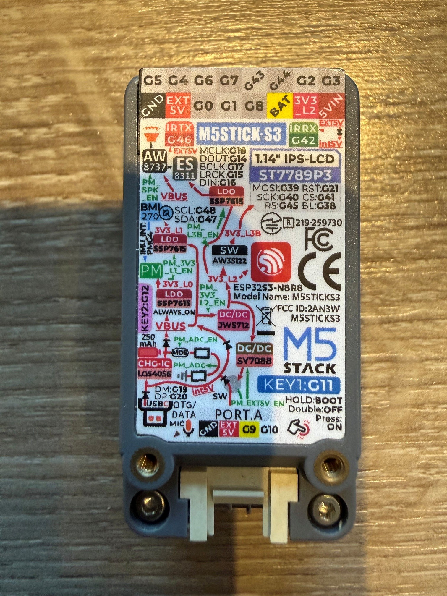

# M5Stack StickS3（K150）硬件知识文档

> 整理与官方网页复核日期：2026-09-15  
> 适用产品：M5Stack StickS3，SKU K150，官方代码标识 `board_M5StickS3`。  
> 本文用途：硬件识别、固件适配、外设接线和使用限制查询。

用于OpenCode语音状态屏项目时，请同时阅读[项目文档索引](./StickS3_OpenCode_文档索引.md)。本文是硬件参考，不是产品测试结果；Arduino/PlatformIO示例不等于已选ESP-IDF固件实现，蓝牙实际适配以项目HIL门槛验证。

## 1. 资料可信度与适用范围

- **官方规格**：以 M5Stack 产品文档 [S1] 为依据。
- **驱动实现**：显示配置以 M5GFX [S2] 为依据，音频、按键和 I²C 配置以 M5Unified [S3] 为依据。库默认设置不等于器件性能极限。
- **实物识别**：用户提供的 `4.jpg` 经 Windows OCR 识别到 `M5STICKS3`、`ESP32S3-N8R8`、`1.14 IPS-LCD`、`ST7789P3` 等文字，与官方型号信息相符。
- **验证边界**：未通过 USB 读取实物芯片信息，未拆机，未执行屏幕、录音、播放、红外或电池测试；本文不是实物验收报告。
- **硬件版本**：官方网页链接的原理图文件名含 `V0.6_20251111`，不代表已确认用户设备就是该 PCB 修订版。
- **不要混用型号**：StickS3 不等于 StickC、StickC Plus、StickC Plus2，也不等于 CoreS3。

原始图片与本文位于同一目录，可打开对照：



### 1.1 已纠正的 OCR 信息

| 项目 | 初次识别 | 核实结果 |
| --- | --- | --- |
| 图片文件名 | 用户输入为 `4.jpgs` | 实际文件为 `4.jpg` |
| 音频 MCLK | GPIO8 | **GPIO18**，官方 PinMap 与源码一致 |
| KEY1 | 疑似 GPIO11 | **GPIO11**，源码确认 |
| 芯片型号 | `ESP32S3-N8R8` | 官方完整型号为 **ESP32-S3-PICO-1-N8R8** |
| 音频 DOUT/DIN | 未明确参照方向 | 本文统一从 ESP32-S3 视角描述，GPIO14 为播放输出，GPIO16 为录音输入 |

## 2. 设备总览

StickS3 是面向遥控、物联网和语音交互的紧凑型可编程控制器，集成屏幕、音频输入输出、六轴 IMU、红外收发、锂电池和扩展接口。[S1]

| 项目 | 官方参数或来源说明 |
| --- | --- |
| 品牌 | M5Stack |
| 产品名称 | StickS3 |
| SKU | K150 |
| 源码板型标识 | `board_M5StickS3` |
| 主控 | ESP32-S3-PICO-1-N8R8 |
| CPU | Xtensa 32 位 LX7 双核，240MHz |
| Flash | 8MB |
| PSRAM | 8MB，Octal 八线接口 |
| 无线连接 | 2.4GHz Wi-Fi |
| 屏幕 | 1.14 英寸 LCD；IPS 描述来自图片 OCR |
| 屏幕分辨率 | 135 × 240 像素 |
| 显示控制器 | ST7789P3 |
| 音频编解码器 | ES8311，单声道，24 位分辨率，I²S |
| 麦克风 | MEMS 麦克风，信噪比 65dB |
| 功放 | AW8737 |
| 扬声器 | 8Ω、1W，2011 腔体扬声器 |
| IMU | BMI270，六轴惯性传感器 |
| 红外 | 内置发射和接收 |
| 电源管理 | M5PM1 |
| 电池 | 内置 250mAh 锂电池 |
| USB 输入 | USB Type-C，DC 5V |
| 按键 | KEY1、KEY2 两个可编程按键，另有电源／复位操作键 |
| Grove 接口 | HY2.0-4P |
| 顶部扩展 | Hat2-Bus，2.54mm 间距，16Pin |
| 背部结构 | 磁吸设计 |
| 产品尺寸 | 48.0 × 24.0 × 15.0mm |
| 产品重量 | 20.0g |
| 包装尺寸 | 65.0 × 25.0 × 15.0mm |
| 包装毛重 | 22.4g |
| 工作温度 | 0～40℃ |
| 官方列出的开发平台 | Arduino、UiFlow2、ESP-IDF、PlatformIO |

说明：24 位是 ES8311 的官方规格，不表示所有固件都采用 24 位音频。电池容量不等于续航承诺；续航依赖屏幕、无线、音量及工作负载。

## 3. 屏幕与显示接口

### 3.1 屏幕引脚

来源：官方 LCD PinMap [S1]，M5GFX StickS3 初始化代码 [S2]。

| 信号 | ESP32-S3 引脚 | 功能 |
| --- | --- | --- |
| MOSI | GPIO39 | SPI 显示数据 |
| SCK | GPIO40 | SPI 时钟 |
| DC／RS | GPIO45 | 数据／命令选择 |
| CS | GPIO41 | 片选 |
| RST | GPIO21 | 显示复位 |
| BL | GPIO38 | 背光控制 |

### 3.2 M5GFX 中的显示配置

| 配置 | 已读取的源码值 | 性质 |
| --- | --- | --- |
| 面板类 | `Panel_ST7789` | 对应官方 ST7789P3 屏幕的驱动实现 |
| `panel_width` | `135` | 有效显示宽度 |
| `panel_height` | `240` | 有效显示高度 |
| `offset_x` | `52` | 显存坐标偏移 |
| `offset_y` | `40` | 显存坐标偏移 |
| `offset_rotation` | `0` | 库的方向偏移设置 |
| `invert` | `true` | 库的反色设置 |
| `spi_host` | `SPI3_HOST` | 库使用的 SPI 控制器 |
| `spi_mode` | `0` | SPI 模式 |
| `freq_write` | `40000000` | 库配置的写入频率，40MHz |
| `freq_read` | `16000000` | 库配置的读取频率，16MHz |
| 独立 MISO | `GPIO_NUM_NC` | 未配置独立 MISO 引脚 |

以上频率不是数据手册给出的绝对上限，也不是刷新率。旋转为横屏后，应用可使用 240 × 135 的逻辑坐标。若绕过 M5GFX 自行编写驱动，应同时处理显存偏移、方向、背光和屏幕供电，而不是只设置分辨率。

## 4. 音频系统

### 4.1 组成

- 采集：MEMS 麦克风经 ES8311 编码，通过 I²S 送至 ESP32-S3。
- 播放：ESP32-S3 通过 I²S 向 ES8311 输出数据，再经 AW8737 功放驱动扬声器。
- ES8311 的控制接口为板载 I²C，7 位地址为 `0x18`。
- 功放使能涉及 M5PM1 的 GPIO3，不是 ESP32-S3 GPIO3。[S1][S3]

### 4.2 I²S 引脚与方向

> 本表的输入／输出统一以 **ESP32-S3** 为参照。对照 ES8311 手册时，芯片一侧的数据方向相反。

| 信号 | ESP32-S3 引脚 | 数据方向／用途 |
| --- | --- | --- |
| MCLK | **GPIO18** | 音频主时钟 |
| BCLK | GPIO17 | I²S 位时钟 |
| LRCK／WS | GPIO15 | I²S 帧时钟 |
| MCU DOUT | GPIO14 | ESP32-S3 → ES8311，播放数据 |
| MCU DIN | GPIO16 | ES8311 → ESP32-S3，录音数据 |
| I²C SDA | GPIO47 | 编解码器控制 |
| I²C SCL | GPIO48 | 编解码器控制 |

M5Unified 中的核对依据：[S3]

```text
麦克风：pin_mck=18，pin_bck=17，pin_ws=15，pin_data_in=16
扬声器：pin_mck=18，pin_bck=17，pin_ws=15，pin_data_out=14
```

### 4.3 软件配置与硬件能力的区别

已读取的 M5Unified 实现为麦克风配置 `I2S_NUM_1`，为扬声器配置 `I2S_NUM_0`；扬声器默认采样率设置为 `22050`，并设置 `stereo=true`。这些是该库版本的软件配置，**不能据此把单声道硬件写成立体声设备，也不能把 22050Hz 当作器件最高采样率**。[S3]

本文未验证录放音同时运行、回声消除、其他采样率或具体应用固件的音频格式。

## 5. I²C 与惯性传感器

### 5.1 板载 I²C

| 项目 | 数值 |
| --- | --- |
| SDA | GPIO47 |
| SCL | GPIO48 |
| ES8311 音频编解码器 | `0x18` |
| BMI270 六轴 IMU | `0x68` |
| M5PM1 电源管理 | `0x6E` |

上述地址均按 **7 位 I²C 地址**记录。[S1][S3]

### 5.2 BMI270

官方确认内置 BMI270 六轴 IMU。官方 PinMap 将 IMU 中断列为连接至 M5PM1 的 GPIO4，名称为 `PYG4_IMU_INT`，不要将其误记为 ESP32-S3 GPIO4。[S1]

传感器量程、输出数据率、轴向与应用坐标变换未在本文独立验证；需要时查阅官方产品页的轴向图与 BMI270 数据手册入口。

### 5.3 外部 I²C

Grove 引出的两根信号线为 GPIO9 和 GPIO10。M5Unified 默认把它们映射为外部 I²C：SDA=GPIO9，SCL=GPIO10。这是默认软件用途，不表示这些 GPIO 只能用于 I²C。[S1][S3]

## 6. 电源管理、供电与功耗

### 6.1 M5PM1 引脚命名

> `M5PM1 GPIOx` 和 `ESP32-S3 GPIOx` 属于不同芯片，编号相同不表示同一信号。

| M5PM1 引脚 | 官方标注的连接／功能 |
| --- | --- |
| GPIO0 | `PYG0_CHG_STAT`，电池充电状态相关 |
| GPIO1 | 连接 ESP32-S3 GPIO13；本表不进一步推断信号语义 |
| GPIO2 | `PYG2_L3B_EN`，L3B 电源使能 |
| GPIO3 | `PYG3_SPK_Pulse`，扬声器功放控制 |
| GPIO4 | `PYG4_IMU_INT`，IMU 中断相关 |

来源：官方 M5PM1 PinMap [S1]。M5GFX 通过 M5PM1 GPIO2 开启 LCD 所需的 L3B 电源；M5Unified 初始化功放控制时配置 M5PM1 GPIO3。[S2][S3]

### 6.2 5V 输入／输出模式

官方说明设备扩展 5V 接口可配置为输入或输出，默认是输入模式。[S1]

| 模式 | 外部供电规则 |
| --- | --- |
| 扩展 5V 输入模式 | 可从 Grove、Hat2-Bus 的 `EXT_5V` 或 `5V_IN` 输入 DC 5V |
| 扩展 5V 输出模式 | 电源输入只允许走 USB 或 Hat2-Bus 的 `5V_IN`；不得向其他已经作为输出的接口反向供电 |

**错误地向输出口注入电源可能造成短路或设备损坏。切换模式前必须核对外部接线。** Grove 上的 5V 电源标注不构成 GPIO 信号脚可承受 5V 的依据。

M5Unified 默认初始化关闭 `EXT_5V_EN`，关闭 Grove、Hat `EXT_5V` 及红外收发相关的扩展供电，并切换至输入模式。无外部 5V 输入而需要红外供电时，可参考官方接口启用输出：[S1]

```cpp
// 在完成 M5Unified 初始化，且确认外部接线不会反向供电后使用。
M5.Power.setExtOutput(true);   // 扩展 5V 输出模式
// M5.Power.setExtOutput(false); // 扩展 5V 输入模式
```

这是官方 API 用法摘录，不是本文已编译或实测的完整程序。

### 6.3 官方功耗表

下表为官方网页在 **4.2V** 条件下列出的电流值；不同状态的完整测试条件未在本文核实。不可把这些值视为所有固件下的保证值。[S1]

| 官方状态名称 | 电压 | 电流 |
| --- | --- | --- |
| Power off | 4.2V | 14.02µA |
| L1 state | 4.2V | 52.47µA |
| L2 state | 4.2V | 102.40µA |
| L3A state | 4.2V | 36.69mA |
| Full load | 4.2V | 519.02mA |

官方 Grove 负载能力表列出：空载 5V，最大负载点 `4.88V @ 0.38A`。不要直接将其推广为任意电池电量、温度和负载条件下都能稳定输出 0.38A。

## 7. 按键、红外和扩展接口

### 7.1 可编程按键

| 名称 | 引脚 | M5Unified 状态逻辑 |
| --- | --- | --- |
| KEY1／BtnA | GPIO11 | 低电平表示按下 |
| KEY2／BtnB | GPIO12 | 低电平表示按下 |

来源：官方 PinMap 和 M5Unified 按键状态读取逻辑。[S1][S3]

### 7.2 电源／复位键

官方给出的操作规则：[S1]

- 单击：开机／复位。
- 双击：关机。
- 长按：进入下载模式。
- 下载操作：先连接 USB，再长按设备侧面的复位键，内部绿色 LED 闪烁表示进入下载模式。

不要把上述电源／复位键操作直接套用到 KEY1 或 KEY2。

### 7.3 红外

| 功能 | ESP32-S3 引脚 |
| --- | --- |
| IR_TX 发射 | GPIO46 |
| IR_RX 接收 | GPIO42 |

官方使用限制：[S1]

1. 接收解码必须使用 ESP32 **RMT 外设**，官方明确不支持 GPIO 方式的接收解码。
2. 使用红外接收时必须关闭扬声器功放，否则接收不能正常工作。
3. 收发器应尽量正对，距离不小于 **30cm**，过近可能导致接收异常。
4. 检查扩展 5V 模式和红外供电，不能只检查 TX/RX 的 GPIO 配置。

### 7.4 Grove HY2.0-4P

| 线色 | 电气连接 | M5Unified 默认用途 |
| --- | --- | --- |
| 黑 | GND | 地 |
| 红 | 5V | 受扩展 5V 模式影响的电源 |
| 黄 | GPIO9 | 外部 I²C SDA |
| 白 | GPIO10 | 外部 I²C SCL |

来源：官方 `PORT.A / PORT.CUSTOM` 表及 M5Unified 外部 I²C 引脚表。[S1][S3]

### 7.5 Hat2-Bus 16Pin

以下保持官方编号和左右栏位。**从设备正面、背面或插头侧观察可能产生镜像，接线必须对照官方图和实物定位，不可只凭本表猜方向。** [S1]

| 左列针号 | 信号 | 右列针号 | 信号 |
| --- | --- | --- | --- |
| 1 | GND | 2 | GPIO5 |
| 3 | EXT_5V | 4 | GPIO4 |
| 5 | Boot | 6 | GPIO6 |
| 7 | GPIO1 | 8 | GPIO7 |
| 9 | GPIO8 | 10 | GPIO43 |
| 11 | BAT | 12 | GPIO44 |
| 13 | 3V3_L2 | 14 | GPIO2 |
| 15 | 5V_IN | 16 | GPIO3 |

`Boot`、`BAT`、`3V3_L2` 等名称按官方原文保留，未在本文中推断其容许负载或完整时序。特别注意 `EXT_5V` 与 `5V_IN` 在输出模式下的供电规则不同。

## 8. 使用限制与兼容性

### 8.1 电池供电的音量限制

USB 未连接、仅由电池供电时，官方建议扬声器音量保持在 **75% 以下**，避免功耗过高导致意外重启。这是官方使用建议，不代表任何库的数值参数都应直接写成 `75`。[S1]

### 8.2 结构兼容性

官方明确以下产品与 StickS3 **结构不兼容**：[S1]

| 配件 | SKU |
| --- | --- |
| Hat Mini JoyC | U156 |
| Hat Mini EncoderC | U157 |
| Hat 18650C | U080 |

未被列入此表的配件，不等于已经确认机械和电气兼容。

### 8.3 批次与拆机注意事项

- 官方说明早期批次可能在启动后产生轻微异响，不影响功能使用；这不等于用户设备已经发现该现象。
- 官方不建议擅自拆开外壳，可能损坏天线相关电路并影响正常使用。
- 更换驱动库或固件后，应重新核对电源初始化、按键行为和音频配置，不能把当前库实现当作永久不变的硬件协议。

## 9. 开发与固件适配索引

### 9.1 官方仓库的职责

| 仓库 | 主要用途 |
| --- | --- |
| [M5Unified](https://github.com/m5stack/M5Unified) | 板型识别、按键、音频、IMU、电源及板级接口 |
| [M5GFX](https://github.com/m5stack/M5GFX) | 显示器初始化与图形接口 |
| [M5PM1](https://github.com/m5stack/M5PM1) | 电源管理芯片驱动 |
| [M5_Hardware / K150_StickS3](https://github.com/m5stack/M5_Hardware/tree/master/Products/K150_StickS3) | 该型号硬件资料入口，已检索目录提供 Structures |

不要以为必须存在独立的 `m5stack/M5StickS3` 仓库；本次核实的官方支持代码主要位于上述统一驱动仓库。

### 9.2 官方 PlatformIO 配置参考

以下为 2026-09-15 官方产品页提供的配置摘录。[S1] **未在用户环境编译验证**，未来使用时需检查平台版本与库版本兼容性；库 URL 未固定提交，构建结果可能随上游变化。

```ini
[env:m5stack-sticks3]
platform = espressif32@6.12.0
board = esp32-s3-devkitc-1
framework = arduino
board_build.arduino.partitions = default_8MB.csv
board_build.arduino.memory_type = qio_opi
build_flags =
    -DESP32S3
    -DBOARD_HAS_PSRAM
    -mfix-esp32-psram-cache-issue
    -DCORE_DEBUG_LEVEL=5
    -DARDUINO_USB_CDC_ON_BOOT=1
    -DARDUINO_USB_MODE=1
lib_deps =
    M5Unified=https://github.com/m5stack/M5Unified
    M5PM1=https://github.com/m5stack/M5PM1
```

此处 `esp32-s3-devkitc-1` 是官方示例使用的构建板定义，并不改变实物型号 StickS3（K150）。

### 9.3 小智语音助手

官方提供 [StickS3 小智语音助手教程](https://docs.m5stack.com/en/guide/realtime/xiaozhi/sticks3)，产品页说明可通过 M5Burner 烧录对应固件。本文只记录入口，未确认用户当前固件版本、分区布局或小智设备激活状态，也未执行烧录。

## 10. 尚未确认的信息

以下内容不得从近似型号、芯片通用能力或 OCR 残片直接补填：

- 用户实物 PCB 修订版本、批次及是否有维修／改装。
- Flash、PSRAM 的实际检测结果与当前固件占用。
- 当前固件名称、版本、启动日志、分区布局。
- 蓝牙版本和当前固件支持情况：本次采用的产品规格表仅明确列出 2.4GHz Wi-Fi。
- USB OTG 的具体工作模式、供电实现与应用固件支持情况：图片有相关文字，但未实测。
- 电池额定电压、充电电流、循环寿命、实际续航及健康状态。
- 麦克风具体料号、红外接收器具体料号、红外载波范围和有效距离上限。
- 屏幕触摸能力：本次资料未确认，不能把屏幕称为触摸屏。
- 摄像头、存储卡等未在本次规格中确认的外设，不应默认为板载。
- ES8311 所有可用采样率、应用中的采样位宽、录放音并发及回声消除效果。
- 所有 Hat 配件的电气兼容性以及扩展电源各状态的完整时序。

## 11. 资料来源与追溯

### 已读取的主要来源

- **[S1] M5Stack 官方 StickS3 产品文档**：规格、PinMap、注意事项、供电、下载模式、PlatformIO 配置。  
  <https://docs.m5stack.com/en/core/StickS3>
- **[S2] M5GFX 显示初始化源码**：`src/M5GFX.cpp`，查找 `board_M5StickS3`，核对屏幕总线、GPIO、尺寸和偏移。  
  <https://github.com/m5stack/M5GFX/blob/master/src/M5GFX.cpp>
- **[S3] M5Unified 板级源码**：`src/M5Unified.cpp`，查找 `board_M5StickS3`、`_pin_table_i2c_ex_in`、`_speaker_enabled_cb_sticks3`，核对 I²C、音频和按键。  
  <https://github.com/m5stack/M5Unified/blob/master/src/M5Unified.cpp>
- **[S4] 官方硬件目录**：已通过 GitHub API 确认 `Products/K150_StickS3` 目录存在且包含 `Structures`。  
  <https://github.com/m5stack/M5_Hardware/tree/master/Products/K150_StickS3>

源码链接指向可变化的 `master` 分支，本文未固定提交哈希。后续追溯以板型和符号名定位，不依赖可能漂移的行号。

### 官方产品页提供的进一步资料入口

以下链接由 [S1] 列出，本文未逐份阅读 PDF 或下载结构文件，**不能把链接存在当作已核实其中全部内容**。

- [StickS3 原理图 PDF，文件名含 V0.6_20251111](https://m5stack-doc.oss-cn-shenzhen.aliyuncs.com/1207/K150_Stick_S3_PRJ_V0.6_20251111_2025_11_17_16_10_24.pdf)
- [StickS3 尺寸 PDF](https://m5stack-doc.oss-cn-shenzhen.aliyuncs.com/1207/K150-sticks3.pdf)
- [StickS3 结构文件](https://github.com/m5stack/M5_Hardware/tree/master/Products/K150_StickS3/Structures)
- [M5PM1 数据手册](https://m5stack-doc.oss-cn-shenzhen.aliyuncs.com/1207/M5PM1_Datasheet_EN.pdf)
- [ESP32-S3 技术参考手册](https://m5stack-doc.oss-cn-shenzhen.aliyuncs.com/477/esp32-s3_technical_reference_manual_en.pdf)
- [ES8311 数据手册](https://m5stack.oss-cn-shenzhen.aliyuncs.com/resource/docs/products/atom/Atomic%20Echo%20Base/ES8311.pdf)
- [BMI270 数据手册](https://m5stack.oss-cn-shenzhen.aliyuncs.com/resource/docs/datasheet/core/K128%20CoreS3/BMI270.PDF)
- [StickS3 Arduino 入门](https://docs.m5stack.com/en/arduino/m5sticks3/program)
- [StickS3 M5PM1 电源管理说明](https://docs.m5stack.com/en/arduino/m5sticks3/m5pm1)

## 12. 更新规则

1. 新参数应附官方来源、源码符号或实测条件，注明记录日期。
2. 区分官方标称值、软件配置值、实测值和待确认信息。
3. 出现资料冲突时保留冲突说明，核对板型、PCB 版本和源码版本，不静默覆盖。
4. 引脚必须注明所属芯片，音频数据线必须注明输入／输出参照方向。
5. 实测记录应说明供电方式、固件版本与外设状态；不要用单次测量替代额定规格。

---

## 附录 B：音频时基实测（2026-09-23，进行中）

> 本节为**本项目实测**，优先级高于本文引用的库默认值；修复未完成前不得当作"已解决"。

| 项 | 实测值 | 说明 |
| --- | --- | --- |
| I2S 驱动配置（ESP32 侧） | sclk=160MHz / **mclk=4.096MHz** / bclk=512kHz | 由 `i2s_channel_get_info()` 读出，**与设计一致** |
| 设备实际采样率 | **≈40.96 kHz**（= MCLK÷100） | 1kHz 纯音端到端测试：录音中出现 **389Hz**（比值 0.389） |
| 链路假设 | 16 kHz | 全链（S3P/Opus/解码/ASR）均按 16kHz |
| 后果 | **时间拉伸 2.56 倍** | 变声/变速/听不清 → ASR 幻觉；`480000 样本耗时 19.7s`（16kHz 应 30s）为旁证 |

**已排除**：Opus 参数（TOC=SILK/WB/16k/60ms/单声道）、解码链（440Hz 合成音解出 439Hz）、数据完整性（FNV-1a 逐字节一致）。

**定位**：ES8311 时钟分频配置与驱动假设不符（实际 ÷100 vs 意图 ÷256），属**固件 codec 配置问题**，非硬件损坏。

**修复候选**：I2S `mclk_multiple` 改 384/512（MCLK 6.144M/8.192M）并同步 codec `mclk_frequency`；或用 1kHz 测试音 FFT 逐项验证。**勿据此节修改任何"已确认"参数**——修复完成前保持进行中状态。
