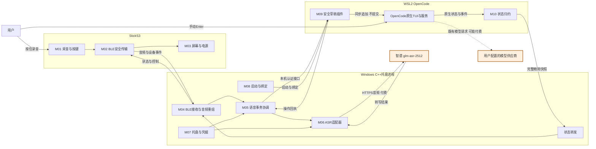
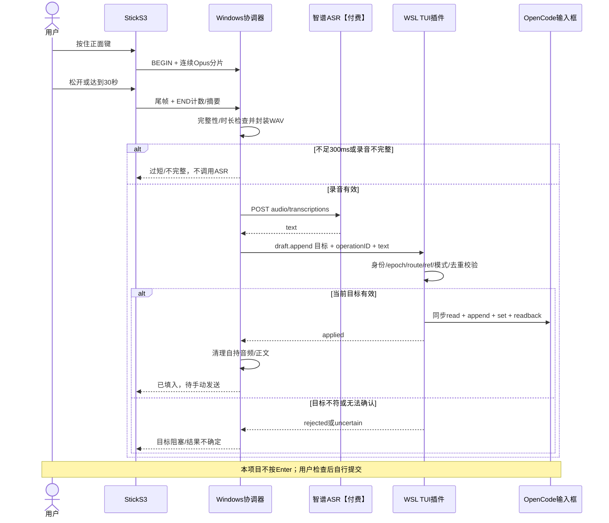
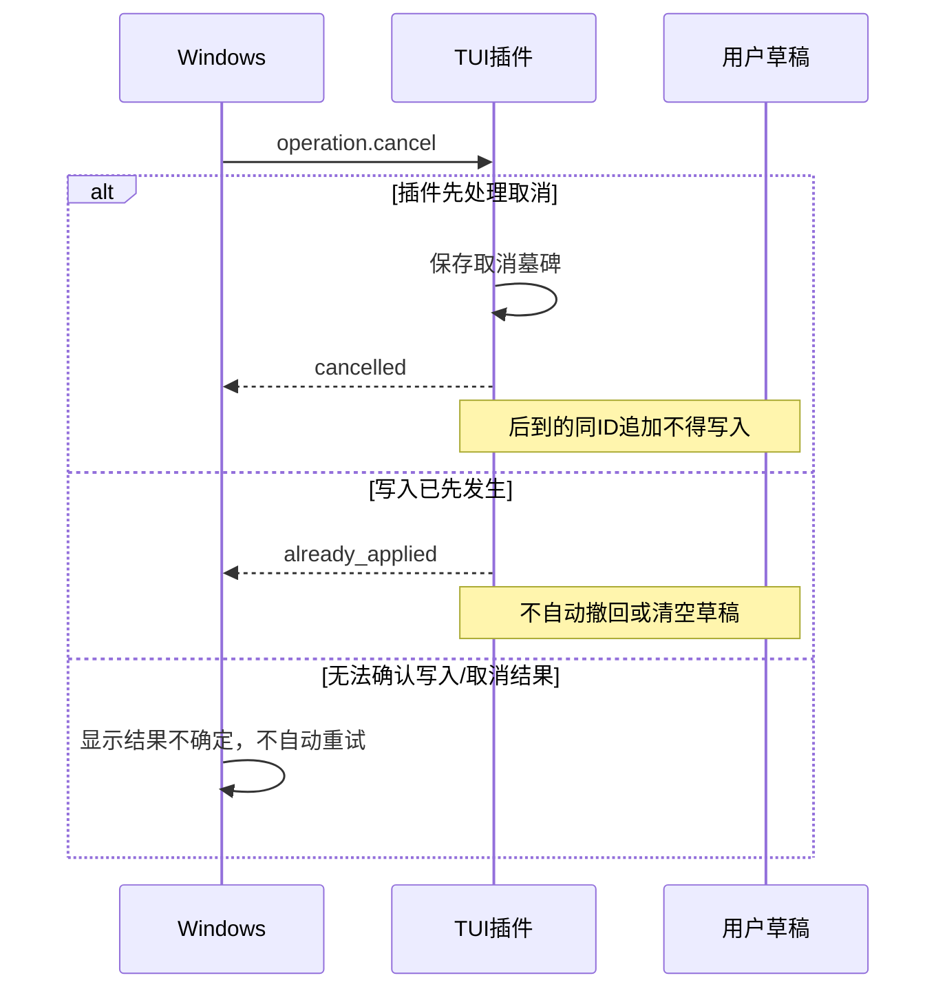

# StickS3 × OpenCode：基于功能模块的HLD

> 版本：HLD 1.0，2026-09-15。  
> 阅读目标：看清“有哪些模块、各自做什么、用什么技术、数据怎么走、调用哪些API、哪里会付费”。  
> 这是设计文档，不是已部署接口说明。已批准需求沿用现有设计；本页新整理的本项目路由/字段为**接口设计草案**，未实现、未通过运行验收。

申请Key和首次调用的独立操作步骤见：[智谱ASR API申请与配置操作手册](./智谱ASR_API申请与配置操作手册.md)。

## 1. 一分钟看懂整个系统

**产品：一个蓝牙语音输入器，加一个OpenCode状态屏。**

```text
                         ① 语音输入：唯一新增付费链路

你按住正面键讲话
       │
       ▼
┌─────────────────┐  加密BLE   ┌──────────────────────────┐
│ StickS3         │ ─────────► │ Windows C++托盘程序       │
│ 采音、Opus编码   │ 音频/按键  │ 收音→完整性检查→内存WAV   │
│                 │           │              │            │
│ 三页状态屏       │           │              ▼            │
│ 电量、提示音     │           │ 智谱ASR适配器 ──HTTPS──────┼──► 智谱云【付费】
└─────────────────┘           │              ▲            │      │
       ▲                      │              └── 转写文字 ─┼──────┘
       │                      │              │            │
       │                      └──────────────┼────────────┘
       │                                     │ 本机认证HTTP
       │                                     ▼
       │                       ┌─────────────────────────┐
       │                       │ WSL2：OpenCode TUI插件   │
       │                       │ 校验会话→追加草稿→回执    │
       │                       └─────────────┬───────────┘
       │                                     │ 不自动发送
       │                                     ▼
       │                          你检查草稿、手动按Enter
       │                                     │
       │                                     ▼
       │                          OpenCode所选模型【可能付费】
       │
       └── BLE状态 ── Windows ◄── 插件归约 ◄── OpenCode状态/事件

                         ② 状态屏：本地读取，无新增模型调用
```

**两条链路独立**：转写失败不等于OpenCode任务失败；OpenCode忙碌不阻止录音。状态读取不会自动触发新的编程任务。

### 1.1 可渲染的模块关系图

支持Mermaid的Markdown阅读器可直接显示下图；不支持时，上方文本图仍可阅读。



图中的模块是**职责边界，不代表11个独立服务**。运行时主要是设备固件、一个Windows托盘进程、OpenCode进程内的TUI插件；不新增远程业务服务器或数据库。

## 2. 费用与数据外发：先看这一表

| 编号 | 调用 | 是否付费 | 谁触发 | 发出什么 |
| --- | --- | --- | --- | --- |
| PAY-01 | 智谱语音转文本API | **付费云API**；单价/额度以账号和当前官方计费为准，本文不猜金额 | 有效完整录音首次转写，或用户明确点“重试识别” | WAV、模型名、通用热词、随机请求ID |
| PAY-02 | OpenCode已有模型供应商API | **可能付费**，取决于用户现有模型/套餐 | 用户手动发送后由OpenCode执行；运行中的任务也可能继续消耗 | OpenCode自身构建的消息/上下文，本项目不重写其协议 |
| LOCAL | BLE、Windows系统API、自建本机桥接、OpenCode状态/草稿API | **无新增按次云API费**，仍有本机资源消耗 | 程序与用户操作 | 音频、本地状态、草稿及控制数据，按各模块限制 |
| TEST | 本地受控ASR测试服务 | 无厂商识别调用费 | 自动化测试 | 专用fixture，不调用真实GLM |
| TEST-CLOUD | 自动化真实ASR验收 | **与PAY-01同样可能计费** | 独立授权的真实云测试任务 | 获授权测试录音；不能每次CI无控制调用 |

### 费用边界

- **重试识别可能再次付费；重试填入、查询回执、同步状态、蓝牙重连不会新增ASR调用。**
- ASR请求已发出后取消/超时，不保证供应商停止处理或不计费；`request_id`不等于计费幂等承诺。
- 固件和插件不保存智谱Key，Key仅由Windows凭据管理器管理。
- 不额外调用DeepSeek/GLM聊天模型润色，不做TTS，不调用付费搜索，不设置其他ASR云回退。
- OpenCode状态屏展示的费用是OpenCode报告的估算口径，不包含ASR账单，不等于账号余额。

## 3. 功能模块与技术栈

| 模块 | 功能与不负责的事 | 所在位置/技术栈 | 输入 → 输出 | 对应接口 |
| --- | --- | --- | --- | --- |
| M01 采音与按键 | 按住录音、松开/30秒硬停、300ms过滤依据；不判断人声、不提交文字 | StickS3；C/C++、ESP-IDF 5.5.x、ES8311/I²S、Opus | 麦克风/按键 → 16kHz单声道音频帧/录音事件 | BLE-API-01/02/03/04；HW-01/02 |
| M02 BLE安全传输 | 可信主机绑定、加密、分帧发送、连接状态；不以设备名称当认证 | StickS3 NimBLE；Windows C++/WinRT | 编码帧/控制 → 加密GATT消息 | BLE-API-00—06；WIN-02 |
| M03 屏幕、提示与电源 | 状态/任务/用量三页，侧键切页，错误/等待短音，60秒电池息屏且保连 | 固件；LVGL、ST7789 SPI、M5PM1 I²C、GPIO/PWM | 精简快照/电量/按键 → 屏幕/背光/短提示音 | BLE-API-05/06；HW-02/03/04 |
| M04 音频接收与重组 | 验证ID/序号/分片/END，Opus解码和内存WAV；缺片不靠PLC伪造完整音频 | Windows；C++20、C++/WinRT、libopus | BLE音频 → 完整WAV或明确不完整错误 | BLE-API-01—03；INT-01 |
| M05 语音事务协调 | 单事务、ASR/填入分离、5分钟失败保留、取消/锁屏/到期、手动重试 | Windows；C++状态机、有界内存队列、时钟 | 音频/ASR结果/用户事件 → 请求、回执状态、清理 | INT-01—05；BR-01—06 |
| M06 ASR适配 | 调用唯一GLM-ASR，检查响应，不做语义润色 | Windows；WinHTTP、JSON解析、内存multipart | WAV/Key/热词 → text或分类错误 | **PAY-01**；WIN-03 |
| M07 托盘与凭据 | 设备/连接/Key配置、识别重试与填入重试、取消/退出；不自动发消息 | Windows；Win32 `Shell_NotifyIconW`、Credential Manager、系统事件 | 用户菜单/OS事件 → 协调器命令 | UI-API-01—07；WIN-01/04/05 |
| M08 专用启动与绑定 | 确定发行版/目录/服务/会话/epoch；安全交接，不猜最近会话 | Windows启动入口＋WSL启动辅助；子进程IPC/本地管道 | 显式目标 → 本机绑定描述及专用OpenCode TUI | IPC-01—03；OC-01/02/03 |
| M09 安全草稿插件 | 当前route/ref原子校验、追加末尾、去重/撤销/回执；绝不调用submit | WSL；TypeScript、Bun运行环境、`@opencode-ai/plugin/tui` | 追加/取消请求 → applied/rejected/uncertain等 | BR-01—06；TUI-API-01—05 |
| M10 OpenCode状态归约 | 忙碌/等待/错误/工具/待办/模型/累计用量；过滤正文，不猜任务完成 | 同一TUI插件；SDK/state/event | 原生事件/快照 → 完整精简状态快照 | OC-04—10；TUI-API-01/04/05；BR-03 |
| M11 测试与本地交付 | Selective TDD、协议/故障注入、实机验证、2小时首测、源码/产物/许可 | 独立测试工具与构建流水线；框架待锁定 | fixture/构建版本 → 真实报告/本地交付包 | TEST-API-01—03；USB-01 |

已选Windows C++路线，不把Python原型当正式主机。ESP-IDF补丁版、JSON/测试库、中文字体、构建工具精确版本仍需锁定；表中技术栈不是声称已全部安装或编译成功。

## 4. 四条数据流

### 4.1 语音→草稿主流程



录音传输发生在说话期间，不等松键后才发送整段。30秒16kHz/16bit/mono PCM为960,000字节，标准WAV约960,044字节；Opus 20kbit/s理论载荷约75,000字节，不含协议头。

### 4.2 状态→设备反向流

```text
OpenCode会话/事件
   → M10按绑定session过滤与归约
   → 完整精简快照(epoch + revision + 字段可用性)
   → BR-03 SSE传到Windows
   → M05合并本地语音阶段，但不篡改编程状态
   → BLE-API-05主机状态下发
   → M03刷新三页/提示音
```

**每10秒心跳表示连接存活，不证明OpenCode数据有效。** 15秒未取得有效状态更新显示过期/未知；状态值即使没改变，成功的权威读取也可证明新鲜，单纯重发缓存不能。

### 4.3 失败、重试与计费

```text
ASR失败 → 保留完整音频最多5分钟 → 用户点“重试识别” → 再调PAY-01【可能再次计费】
ASR成功但未填入 → 保留text、清理audio → 用户点“重试填入” → 仅调用BR-04【无ASR费】
ACK丢失 → 查询BR-05 → 不盲目重发
回执unknown/epoch变化 → 结果不确定 → 人工检查，不自动追加
BLE断线 → 自动重连可信设备 → 同步状态，不重放上述任何事务
```

首次失败/阻塞开始计5分钟，重试不延长。锁屏/睡眠/休眠清理优先，恢复后不继续旧录音。已写入的文本属于用户草稿，不自动删除。

### 4.4 取消竞态



这是已批准的取消边界，不承诺Windows点取消的瞬间能撤销远端已经发生的写入。

## 5. API地图与状态标识

**“全部API”范围：本项目设计会调用或提供的跨模块/跨进程/跨设备接口，以及明确禁止误用的相关接口；不是罗列整个Windows SDK或全部OpenCode管理API。**

| 前缀 | 接口类别 | 当前成熟度 | 费用 |
| --- | --- | --- | --- |
| PAY | 外部模型云接口 | 智谱接口已查官方文档，未账号实测；模型供应商随OpenCode配置 | **付费/可能付费，逐项注明** |
| BR | Windows到TUI插件的窄桥接 | 既有逻辑操作的本页HTTP映射草案，未实现、未冻结 | 本地，无按次云费 |
| OC | OpenCode原生服务/CLI | 依据1.18.30核查与官方文档；不能当本项目已联调 | 本地读取/建空会话无新增模型费 |
| TUI-API | 插件进程内原生API | 类型/源码有依据，组合运行待验 | 本地，无按次云费 |
| BLE-API | 自定义GATT语义 | 协议设计；UUID/二进制布局待冻结 | 本地无线，无按次云费 |
| UI-API/INT/IPC | 主机内部命令/组件/启动接口 | 逻辑接口，不是已存在HTTP端点 | 仅识别重试可间接触发PAY-01 |
| WIN/HW/USB | 操作系统/芯片/刷写接口 | 平台API或硬件接口；驱动组合待验 | 无按次云费 |
| TEST-API | 受控测试接口 | 设计中；不作为生产开放接口 | 本地免费，真实云测试除外 |

## 6. 外部云API：付费标记

### PAY-01：智谱语音转文本【付费】

| 项目 | 定义 |
| --- | --- |
| 调用方 → 提供方 | M06 Windows ASR适配器 → 智谱BigModel |
| 方法/地址 | `POST https://open.bigmodel.cn/api/paas/v4/audio/transcriptions` |
| 协议 | HTTPS，`multipart/form-data` |
| 鉴权 | `Authorization: Bearer <API Key>`；Key来自Windows凭据管理器 |
| 必需字段 | `model=glm-asr-2512`；`file`为内存WAV，文件名固定`speech.wav` |
| 本项目选用可选字段 | `stream=false`；通用`hotwords`；随机`request_id` |
| 不选用字段 | 项目上下文`prompt`、用户身份`user_id`、Base64替代上传；不虚构`language`参数 |
| 官方输入限制 | WAV/MP3，≤25MB、≤30秒；hotwords≤100项；request_id长度6—64 |
| 成功响应 | `text`及`id/created/request_id/model`等；以有效非空text为本项目后续输入 |
| 失败 | HTTP/网络失败、401/403/429/5xx、无效JSON/空text/超限响应，分类提示 |
| 超时 | 本项目20秒ASR请求超时；起点细节需HTTP契约冻结 |
| 自动重试 | 不允许；用户明确点识别重试才再发请求 |
| 费用与取消 | 请求可能计费；重试可能重复计费，取消/超时不保证免计费 |
| 数据外发 | 录音、模型、通用热词和随机请求ID；不附带代码、文件路径、会话历史或现有草稿 |
| 证据 | [官方语音转文本API](https://docs.bigmodel.cn/api-reference/模型-api/语音转文本) |

`stream=true`虽然是厂商可选项，但它是文字SSE输出，不是本设计采用的边录边上传协议。首版只接收完整结果，不将半句转录反复追加到草稿。

**计费单价、试用额度、套餐权益与云端保留时长未核实到本用户账号，不在HLD写猜测值。**用户已于2026-09-20确认充值完成（口头确认，金额与账号侧价格未核对）；官方模型页同日复核：支持普通话及主要方言、英语多口音等数十种语言，厂商公布CER 0.0717——属厂商口径，不作为本项目15条验收依据。

### PAY-02：OpenCode所选模型【可能付费，既有系统边界】

本项目不新增这一模型adapter，不选择或更改用户供应商，也不配置其API Key。具体URL/模型/协议由OpenCode当前provider配置决定，未读取秘密配置，故不能虚构固定`/chat/completions`地址。

用户手动发送后OpenCode可能调用该供应商并执行工具；运行中的任务也可能继续调用。M10只读取已有状态/用量，**不会为了刷新状态屏调用模型**。用户启用的其他云工具可能自带费用，不由本HLD统一保证免费。

## 7. BR：本项目窄桥接API设计

### 7.1 服务边界

提供方：WSL内M09/M10所在TUI插件；调用方：Windows M05/M08。

建议基址：`http://127.0.0.1:<bridgePort>/v1`。端口由专用启动绑定确定，不固定写死，不是OpenCode服务端口。下列路径为本页整理的**建议映射，不是OpenCode原生接口**。服务仅监听loopback，不开放局域网。

全接口建议Bearer桥接令牌认证，与智谱Key完全不同；令牌通过受当前用户权限保护的启动IPC交接，不写命令行/普通日志。具体认证schema、限额和Origin策略仍需M1冻结。

### 7.2 六个桥接操作

| ID | 逻辑操作/建议HTTP映射 | 请求 | 响应/事件 | 副作用与重试 | 费用 |
| --- | --- | --- | --- | --- | --- |
| BR-01 | `health`：`GET /v1/health` | 认证 | 协议/插件版本、epoch、存活状态 | 无写入；可安全重复；健康不代表目标可写 | 本地 |
| BR-02 | `binding`：`GET /v1/binding` | 认证 | 绑定session、当前route匹配、bindingRevision、canAppend及阻塞原因 | 只查不切会话；返回值不是未来追加的永久授权 | 本地 |
| BR-03 | `state.subscribe`：`GET /v1/state/stream` | 认证 | SSE完整精简快照、连接心跳；见7.4 | 首次快照/更新/重连重同步；不重播语音命令 | 本地 |
| BR-04 | `draft.append`：`POST /v1/draft/append` | epoch、sessionID、operationID、transactionGeneration、text | applied/rejected/processing/uncertain或错误；不返回完整用户草稿 | **只追加**，同步route/ref检查与去重；失败禁止盲目自动重发 | 本地 |
| BR-05 | `operation.status`：`GET /v1/operations/{operationID}`，携带epoch | 认证、operationID、epoch | applied/rejected/cancelled/processing/unknown/uncertain | 只查询；unknown不证明请求未在途 | 本地 |
| BR-06 | `operation.cancel`：`POST /v1/operations/{operationID}/cancel` | 认证、epoch、目标session与事务身份 | cancelled/already_applied/uncertain或身份错误 | 取消先到保存墓碑；不清空草稿、不abort模型 | 本地 |

BR-04/06使用相同身份校验规则；相同operationID不同正文/目标是冲突。状态码具体映射未冻结，不能把所有业务失败包装成HTTP成功然后忽略result。

### 7.3 BR-04字段示例（新设计草案，不是可直接调用的成品）

```json
{
  "protocolVersion": 1,
  "tuiEpoch": "example-epoch",
  "sessionID": "ses_example",
  "operationID": "example-operation",
  "transactionGeneration": 7,
  "text": "请检查这个 API 的错误处理。"
}
```

示例成功回执：

```json
{
  "tuiEpoch": "example-epoch",
  "operationID": "example-operation",
  "status": "applied"
}
```

`status=applied`只在插件完成实际set/readback及回执记录后发出，不等于“模型已收到消息”。请求期限/取消generation的跨进程表达、回执容量及查询unknown后的细节须在M1冻结，不能从示例推导出不存在的保证。

### 7.4 BR-03精简快照数据字典

| 字段组 | 内容 | 来源/保护 |
| --- | --- | --- |
| 身份与排序 | protocolVersion、tuiEpoch、sessionID、snapshotRevision | 插件生成；旧epoch/旧revision不可覆盖新状态 |
| 绑定能力 | canAppend、阻塞原因 | 当下route/ref/mode/dialog；真正写入仍再次校验 |
| 编程状态 | idle/busy/retry/waiting/error/unknown，子任务附加提示 | 权威状态与pending权限/问题，不读聊天文字猜状态 |
| 项目/会话 | 项目显示名、会话title | 只走本地链路，不发给ASR |
| 工具/待办 | 运行工具名及数量、完成/总数 | 不含工具参数、源码、工具返回正文 |
| 模型 | 当前模型或标注最近使用 | 未报告则unknown |
| 用量 | 输入/输出/推理/缓存分类及OpenCode估算费用 | 根会话当前记录口径，未知不伪装0，币种未核实不编造 |
| 新鲜度 | 权威读取成功状态、过期标记 | 10秒心跳不刷新权威数据；15秒无有效更新标过期 |

Windows本地另合并`voicePhase`、设备电量/充电/连接状态后通过BLE下发；插件不负责伪造设备电量。跨端时钟未对齐前，不靠直接相减两个系统墙钟判过期。

## 8. OC：实际使用的OpenCode原生接口

下列为已有API/CLI能力目录，不是本项目新服务。使用范围限启动/读取；本项目不向Windows暴露任意OpenCode API代理。

| ID | 原生接口/命令 | 功能与输入/输出 | 调用者 | 费用与限制 |
| --- | --- | --- | --- | --- |
| OC-01 | `GET /global/health` | 服务健康与版本 | M08启动检查 | 本地，无新增模型费；前序隔离实测 |
| OC-02 | `GET /session`、`GET /session/{id}`；必要时`POST /session` | 显式选择/获取session，必要时创建空session | M08；M10只读 | 创建空session不等于提交提示词；不猜最近会话 |
| OC-03 | `opencode --port ... --hostname 127.0.0.1 --session ...`；或`opencode attach <url> --session ... --dir ...` | 专用启动/附着 | M08启动器 | 具体启动流程二选一待LLD冻结；不使用`--auto`审批 |
| OC-04 | `GET /session/status` | session→idle/busy/retry映射 | M10或已有TUI SDK同步 | 本地读取，不代表当前可见route |
| OC-05 | `GET /session/{id}/todo` | 待办列表 | M10 | 本地读取；无todo不是100%完成 |
| OC-06 | `GET /session/{id}/message` | 消息/parts快照，模型、工具状态和用量来源 | M10必要补齐 | 可返回正文；必须在WSL过滤，不转发给状态屏/ASR |
| OC-07 | `GET /session/{id}/children` | 已知子会话辅助状态 | M10按需 | 不将子会话费用加入根会话累计 |
| OC-08 | `GET /permission` | pending权限请求列表，按session过滤 | M10 | 只看等待，不审批；不向设备传完整敏感命令 |
| OC-09 | `GET /question` | pending问题列表，按session过滤 | M10 | 只看等待，不代答 |
| OC-10 | `GET /event`，必要时`GET /global/event` | 原生SSE事件；具体范围/封装不同 | 已有SDK同步/M10 | 不假设二者payload相同或无限历史回放；重连取快照 |
| OC-11 | `GET /doc` | 当前进程OpenAPI | 开发/兼容检查 | 本地，只作契约依据 |

M10优先复用TUI已有SDK/state同步，不同时为每个字段再启动一套冗余全局轮询。表内REST是数据来源和补齐入口，不意味着每次心跳必须调用全部接口。

### 8.1 不应使用的原生接口

| 接口 | 本项目规定 | 原因 |
| --- | --- | --- |
| `POST /tui/append-prompt` | 不用作生产安全追加 | 仅text、无session保护；前序实测额外sessionID被忽略，返回true不是TUI写入ACK |
| `POST /tui/select-session` | 不用来掩盖目标不符 | 自动切换不解决检查/写入竞态；用户选择单会话专用 |
| `GET /api/session/active` | 不用于判断当前TUI页面 | 表示运行中的会话，不是可见路由 |
| `POST /tui/submit-prompt`、`/session/{id}/message`、`/session/{id}/prompt_async` | 语音桥接禁止调用 | 会提交而非仅填草稿，可能触发PAY-02及工具执行 |
| 清空草稿、abort、shell、permission/question reply接口 | 窄桥接不提供 | 取消语音不能破坏草稿、停止编程或替用户审批 |

## 9. TUI-API：插件内部调用，不走HTTP

| ID | 原生能力 | 用途 | 关键限制 |
| --- | --- | --- | --- |
| TUI-API-01 | `api.route.current`、`api.state.path` | 校验当前session与项目上下文 | 查询结果和实际set必须在同一同步上下文检查 |
| TUI-API-02 | `api.slots.register`、`session_prompt`、`api.ui.Prompt` | 复用内置Prompt并获取/转发ref | 保留visible/disabled/on_submit和right子槽位，不能破坏原生输入行为 |
| TUI-API-03 | `ref.current`、`ref.set(prompt)` | 读input/mode/parts；追加末尾后同步set/readback | set是整体设置，必须保留旧稿/附件；**不调用ref.submit** |
| TUI-API-04 | `api.state.session.get/status/todo/messages/permission/question`、`api.state.part` | 读取已有同步状态 | 可读字段存在不保证供应商usage真实完整 |
| TUI-API-05 | `api.event.on`、`api.lifecycle.onDispose/signal`、`api.ui.dialog` | 事件更新、清理、模态阻塞检查 | unload撤销epoch；不向KV写转写正文 |

参考基线：匹配的`@opencode-ai/plugin@1.18.30`类型和tag源码。**上述能力存在已核实，项目插件组合后是否正确仍待M1测试。**

## 10. BLE-API：设备与主机的完整逻辑协议

### 10.1 三类GATT承载

1. 音频通知：设备→主机，承载Opus分片。
2. 设备事件：设备→主机，承载录音开始/结束、取消和设备状态。
3. 主机控制/快照：主机→设备，承载就绪、语音阶段和OpenCode精简状态。

这是承载分类，**不是已分配的UUID、特征个数或冻结二进制布局**。通知/指示及分片策略以冻结协议为准，所有音频/控制都受身份和加密门禁。

| ID | 逻辑消息 | 方向 | 主要数据 | 处理与失败语义 |
| --- | --- | --- | --- | --- |
| BLE-API-00 | 配对/身份/能力握手 | 双向 | deviceIdentity、bootID、协议版本、codec能力、协商MTU | 物理允许配对、认证加密；仅一个可信设备，不自动替换bond |
| BLE-API-01 | BEGIN | 设备→主机 | bootID、recordingID、采样率/声道/帧配置 | 主机单事务可用才接纳；不同boot隔离 |
| BLE-API-02 | AUDIO | 设备→主机 | recordingID、32位frameSeq、片号/片数、长度、Opus载荷、有效样本信息 | 相同片去重，冲突/超限失败，缺片不能被掩盖 |
| BLE-API-03 | END | 设备→主机 | recordingID、最终帧数、有效样本总数、停止原因、完整性摘要 | 先到END不代表完整；尾帧等待有界，摘要算法/期限待冻结 |
| BLE-API-04 | DEVICE_CANCEL/按键事件 | 设备→主机 | 当前录音/事务身份、取消/按键类型 | 只终止语音，不提交/审批/abort OpenCode；防过期事件取消新事务 |
| BLE-API-05 | HOST_STATE/READY/HEARTBEAT | 主机→设备 | 完整精简快照、revision、voicePhase、canRecord、结果提示 | 每10秒心跳，15秒无有效状态过期；不以心跳维持背光常亮 |
| BLE-API-06 | DEVICE_STATUS/ERROR | 设备→主机；主机也可下发语音错误状态 | 电量/充电/连接、错误码、当前身份 | 状态/错误不夹带音频正文；重新连接仅同步，不自动识别重试 |

无需云API费用。录音≤30秒，<300ms丢弃；单段Opus载荷限额256KiB。协议头须适配`MTU-3`，不能把大于20字节的头假称支持MTU23。具体字段字节序、头长、UUID、CRC/摘要、尾帧超时尚未给值，必须在M2前冻结。

## 11. Windows内部、启动IPC与系统API

### 11.1 UI-API：托盘命令，进程内调用

下列为逻辑命令，不额外开本地HTTP管理服务。

| ID | 命令 | 输入/输出与副作用 | 费用 |
| --- | --- | --- | --- |
| UI-API-01 | 查看状态 | 设备/绑定/语音阶段/错误及完整标题 | 本地 |
| UI-API-02 | 配对/连接/主动断开 | 显式选设备，保存可信身份；主动断开停止重连；解绑须物理确认 | 本地 |
| UI-API-03 | 保存/替换/删除ASR Key | 通过WIN-04存储，界面仅显示是否已配置，不返回明文 | 本地；不自动付费“验证Key” |
| UI-API-04 | 重试识别 | 对当前未过期完整录音发起新attemptID | **间接调用PAY-01，可能再次付费** |
| UI-API-05 | 重试填入 | 仅明确未写入、目标有效时使用原operationID | 本地，无ASR费 |
| UI-API-06 | 取消语音 | 撤销本地generation、清理自持缓冲，必要时BR-06 | 本地；已发云请求不保证免计费 |
| UI-API-07 | 退出 | 关闭本项目连接/监听/后台任务，不杀用户OpenCode任务 | 本地 |

### 11.2 INT：主机内部功能边界

| ID | 提供方 | 逻辑入口与输出 | 副作用约束 |
| --- | --- | --- | --- |
| INT-01 | M04 | `onAudioFragment / finalizeRecording` → 完整音频或错误 | 有界重组；不写临时音频文件 |
| INT-02 | M06 | `transcribe(recording, attempt)` → text/分类错误 | 唯一外部ASR请求出口，PAY-01 |
| INT-03 | M05 | `begin / end / cancel / expire` → 新语音阶段 | 单事务，300ms/30秒/5分钟规则；旧generation失效 |
| INT-04 | M05 | `retryAsr / retryAppend / queryDelivery` → 阶段/回执 | 禁止自动重试识别，未知结果不重放 |
| INT-05 | M05状态合并器 | `onDeviceState / onOpenCodeSnapshot` → HOST_STATE | 不把录音阶段当OpenCode busy，不把未知当零 |

这些是可测试职责名称，不是承诺已有C++头文件；具体函数签名随实现以测试驱动演进。

### 11.3 IPC：专用启动与绑定交接

| ID | 方向 | 内容 | 约束 |
| --- | --- | --- | --- |
| IPC-01 | Windows启动入口→WSL辅助/CLI | 明确发行版、项目目录、目标session或建空session意图 | 不用最近会话推断；无模型prompt注入 |
| IPC-02 | 启动器/插件↔托盘 | bridge地址、协议版本、tuiEpoch、sessionID、随机桥接凭据 | 用户权限保护的管道/子进程IPC；不得明文Key/令牌进命令行或公共文件 |
| IPC-03 | 插件生命周期→Windows | 就绪/失效/退出信息，必要时通过BR状态更新 | epoch变化使旧请求失效，不能无确认重投 |

精确管道名称、端口分配、凭据交换与Windows/WSL启动握手仍需M1验证。本页不假装它们已实现，也不为直观而捏造固定端口。

### 11.4 WIN：平台能力调用清单

| ID | 平台API/能力 | 使用者与用途 | 费用/注意 |
| --- | --- | --- | --- |
| WIN-01 | `Shell_NotifyIconW`及Win32窗口/菜单消息 | M07托盘图标与菜单 | 本地，无按次云费 |
| WIN-02 | `Windows.Devices.Bluetooth`、GATT；发现/配对/服务发现/ValueChanged/写入 | M02/M04 BLE中央设备 | 本地；具体调用须遵守WinRT线程/配对权限，真实协商待验 |
| WIN-03 | WinHTTP HTTPS请求/取消/代理 | M06调用PAY-01 | WinHTTP本身不收费，目标ASR收费；不能关闭TLS校验 |
| WIN-04 | `CredWriteW / CredReadW / CredDeleteW` | M07/M06当前用户凭据 | 本地；Key不传WSL/设备，不等于抵御同用户恶意进程 |
| WIN-05 | Windows会话锁定、挂起/恢复通知 | M05清理及暂停新输入 | 本地；通知不及时则恢复后先使旧事务失效 |
| WIN-06 | 子进程/受限本地IPC、`wsl.exe` | M08专用启动 | 本地；日常不需要管理员，不改系统安全策略 |

## 12. HW与USB：硬件接口，不是网络API

| ID | 硬件接口 | 用途/关键映射 | 验证边界 |
| --- | --- | --- | --- |
| HW-01 | ES8311 I²S | MCLK18、BCLK17、LRCK15、MCU录音输入16/播放输出14 | 16kHz/mono录音配置，不把芯片24位规格当应用采样位宽 |
| HW-02 | GPIO按键/背光PWM | 正面11、侧面12、背光38 | 按住录音/侧键切页取消；长按阈值/去抖待冻结 |
| HW-03 | SPI ST7789P3 | MOSI39、SCK40、DC45、CS41、RST21；240×135横屏 | 中文字体与显存偏移待实机验证 |
| HW-04 | 板载I²C | SDA47/SCL48；ES8311=0x18、M5PM1=0x6E、BMI270=0x68 | 读取电量/电源控制；M5PM1 GPIO3不是ESP32 GPIO3；IMU非首版核心需求 |
| USB-01 | USB固件刷写/备份工具链 | 首次安装、后续手动升级、恢复 | 无云API费；镜像/分区/地址/备份在刷写前核对并获授权，无OTA |

## 13. TEST-API：自动化测试接口与付费隔离

| ID | 测试能力 | 真实/替身边界 | 费用 |
| --- | --- | --- | --- |
| TEST-API-01 | 受控ASR HTTP服务 | 返回成功/空文本/无效JSON/401/429/5xx/延迟；检查实际请求字段 | 本地，无云费，不作为实际识别质量证据 |
| TEST-API-02 | 可控时钟/BLE故障/乱序/缺片/ACK屏障 | 真实解析器和状态机运行，仅替代外部时间/传输调度 | 本地；不绕过生产认证门禁 |
| TEST-API-03 | HIL/E2E驱动与结果采集 | 真实StickS3、Windows、TUI；云识别单独授权 | **真实ASR步骤可能付费**；2小时常规耐久用受控ASR |

测试入口不进入生产网络面，不增加“测试专用免认证API”。自动化能驱动实机不代表不需要人确认配对、语义争议和物理体验。

## 14. 接口共用规则

### 14.1 身份不可混用

`deviceIdentity`认证设备；`bootID`隔离设备重启；`recordingID`标识一段录音；`attemptID`标识一次ASR请求；`operationID`标识一次草稿追加；`transactionGeneration`隔离旧回调；`tuiEpoch`隔离TUI生命周期；`snapshotRevision`排序状态。ASR request_id不复用真实sessionID。

### 14.2 持久化与清理

- 持久保存：Windows凭据集中的Key、设备bond、必要非正文配置、构建/测试元数据。
- 不主动持久保存：日常录音、转写历史、完整草稿、工具正文。失败音频或阻塞text最多5分钟，重试不延长。
- 锁屏/挂起取消清理本项目副本；已写入的用户草稿保留。OS分页/休眠转储及云厂商留存不在本项目零留存保证内。

### 14.3 禁止能力

设备/桥接不提供自动提交、权限审批、Shell执行、任意文件访问、自动更换供应商、录音排队、OTA或账号余额查询。不得用“调试接口”绕过这些限制。

## 15. 当前参数、验收与未定项

| 参数 | 当前批准值/规则 |
| --- | --- |
| 录音 | 按住开始、松开结束，≤30秒；<300ms不调用ASR |
| 音频 | 16kHz/mono/16bit；Opus60ms、20kbit/s；单段载荷≤256KiB |
| ASR | glm-asr-2512，20秒请求超时，无自动重试 |
| 失败保留 | 主机内存最多5分钟，取消/退出/锁屏/挂起清理 |
| 电池息屏 | **无用户操作60秒**；BLE保持连接 |
| 心跳/数据过期 | **10秒心跳；15秒无有效状态更新过期** |
| 语音时延 | 5s/10s/30s录音各5次，每组5次松键后5秒内成功填入（2026-09-23 修订；见 Q03 契约 v1.1） |
| 识别质量 | 固定15条，至少14条≤2处局部修正且不重写整句；关键语义错误整句不合格（2026-09-24 由 30/≥27 修订） |
| 蓝牙 | 同一工位约0.3～2米，无墙；自动重连已绑定设备，20次至少19次15秒内恢复加密与状态 |
| 稳定性 | 插电先连续2小时自动化首测，再由用户决定是否追加 |
| 电池续航 | 先实测，再由用户决定是否优化，不猜最低小时数 |
| 交付 | 完整本地源码/产物/自动化测试/说明/MIT及第三方许可；GitHub发布另行授权 |

**尚未冻结，但不影响理解HLD的项目**：BR具体路径/状态码/长度与回执容量/在途期限；BLE UUID/二进制头/摘要/尾帧等待；安全IPC交接；长按/去抖；中文字体；具体语料与测试负载；精确依赖版本。新增BR路径仅是HLD映射草案，不能被“其他都通过”的历史批准追溯为已批准新接口。

下一阶段先验证M1安全草稿通道，再接入真实BLE与付费ASR，不以画出架构图代替可用系统。完整测试和DoD仍见[测试矩阵](./StickS3_OpenCode_测试用例与追踪矩阵.md)、[交付定义](./StickS3_OpenCode_交付节点与完成定义.md)。

## 16. 来源与配套资料

- [原设计及用户决策](./StickS3_OpenCode_语音状态屏_设计文档.md)、[集中审阅记录](./StickS3_OpenCode_方法论审查与决策.md)、[契约C01—C10](./StickS3_OpenCode_契约与演进设计补充.md)。
- [现场接口实验与源码证据](./StickS3_OpenCode_可行性核查.md)：普通append不保护session、Windows→WSL localhost、插件类型、累计费用口径。
- [智谱ASR官方API](https://docs.bigmodel.cn/api-reference/模型-api/语音转文本)、[GLM-ASR-2512](https://docs.bigmodel.cn/cn/guide/models/sound-and-video/glm-asr-2512)（2026-09-20复核：端点、25MB/30秒限制与本HLD一致）、[价格入口](https://open.bigmodel.cn/pricing)、[官方体验中心](https://bigmodel.cn/trialcenter/modeltrial/voice)、[隐私政策](https://docs.bigmodel.cn/cn/terms/privacy-policy)。只读取文档，未使用Key调用；用户确认充值后亦未发起真实识别。
- [OpenCode Server官方文档](https://opencode.ai/docs/server/)、[TUI配置schema](https://opencode.ai/tui.json)。精确实现以1.18.30运行时和匹配源码为准。
- [v1.18.30 TUI Prompt实现](https://github.com/anomalyco/opencode/blob/3104c1428ec91f809e5ab86631300de41eb6952e/packages/tui/src/component/prompt/index.tsx)、[TUI追加handler](https://github.com/anomalyco/opencode/blob/3104c1428ec91f809e5ab86631300de41eb6952e/packages/opencode/src/server/routes/instance/httpapi/handlers/tui.ts)。
- [v1.18.30原生Session接口定义](https://github.com/anomalyco/opencode/blob/3104c1428ec91f809e5ab86631300de41eb6952e/packages/opencode/src/server/routes/instance/httpapi/groups/session.ts)、[Permission接口](https://github.com/anomalyco/opencode/blob/3104c1428ec91f809e5ab86631300de41eb6952e/packages/opencode/src/server/routes/instance/httpapi/groups/permission.ts)、[Question接口](https://github.com/anomalyco/opencode/blob/3104c1428ec91f809e5ab86631300de41eb6952e/packages/opencode/src/server/routes/instance/httpapi/groups/question.ts)：本轮回读核对状态、待办、消息、子会话和等待交互读取接口。
- [硬件知识与原图](./M5StickS3_硬件知识文档.md)、[78/voicestick](https://github.com/78/voicestick)、[zoe-huang1/sticks3-voice-input](https://github.com/zoe-huang1/sticks3-voice-input)、[TaskHub](https://github.com/sheepxux/Taskhub-for-StickS3)。仅复用已核实适配/许可部分，不继承HID/OTA/不安全绑定配置。
